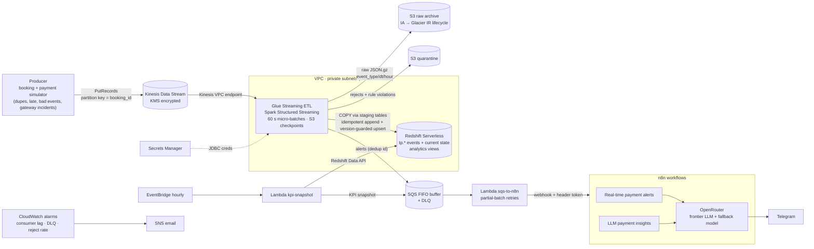

# TicketPulse — Real-Time Ticket Booking & Payment Analytics Platform

**AWS · Kinesis Data Streams · AWS Glue Streaming ETL (Spark Structured Streaming) · Redshift Serverless · S3 · CloudFormation · VPC · Secrets Manager · SQS · Lambda · n8n · OpenRouter (frontier LLM)**

A real-time analytics platform for an event-ticketing business (movies, concerts, sports) in India.
Booking and payment events (UPI, cards, netbanking, wallets across four gateways) stream through
**Kinesis** into a **Glue Streaming ETL** job that validates, de-duplicates and loads them into
**Redshift Serverless** every minute while archiving the raw events to **S3**. The same job evaluates
alert rules in real time; alerts and hourly KPI snapshots are buffered in **SQS** and handed to **n8n**,
which calls a frontier LLM through **OpenRouter** to triage incidents and write payment insights,
then posts them to Telegram. Everything is provisioned as code with **CloudFormation inside a VPC**,
with credentials in **Secrets Manager**.

## Architecture



## How the resume bullets map to the code

| Resume bullet | Where it lives | Key details |
|---|---|---|
| Real-time pipeline: **Kinesis → Glue Streaming ETL (Spark Structured Streaming) → Redshift Serverless**, raw events archived to **S3** | `producer/`, `glue/streaming_job.py`, `glue/ticket_etl/`, `redshift/` | Glue catalog table over Kinesis is the event contract. Each 60 s micro-batch: archive raw → validate (11 rules, rejects to quarantine) → dedupe on `event_id` → COPY into staging tables → **insert-only anti-join** for event tables and **version-guarded delete+insert** for current state (late/replayed events can't overwrite newer state). S3 checkpoints = resume where it stopped. |
| **CloudFormation inside a VPC**, **Secrets Manager** for credentials, **SQS** for message buffering | `infra/01..04-*.yaml`, `scripts/deploy.sh` | 4 stacks wired with exports/imports. Redshift + Glue in private subnets, Redshift SG only accepts 5439 from the Glue SG, Kinesis + S3 VPC endpoints, NAT or full interface-endpoint egress mode. Redshift admin password generated by Secrets Manager and injected with a dynamic reference; Glue connection uses `SECRET_ID`. **SQS FIFO** buffers alerts/snapshots between the stream and n8n (deterministic dedup ids, partial-batch retries, DLQ + alarm). |
| Automated **alerts** and **LLM-generated payment insights** with **n8n** calling a **frontier LLM via OpenRouter** | `n8n/workflows/`, `lambdas/` | Glue raises `PAYMENT_FAILURE_SPIKE`, `PAYMENT_METHOD_DEGRADED`, `HIGH_VALUE_PAYMENT_FAILED`. n8n dedupes, asks the LLM for likely causes / next actions (JSON mode, fallback model, retries) and posts to Telegram. Hourly KPI snapshot (aggregates only, no PII) → LLM writes the insight report; a **groundedness check** flags any number the model quotes that isn't in the data. |

## Repo layout

```
infra/
  01-network.yaml            VPC, subnets, NAT or interface endpoints, S3 + Kinesis endpoints, SGs
  02-data.yaml               Kinesis, S3 (raw + artifacts), SQS FIFO + DLQ, secrets, Redshift Serverless
  03-glue-streaming.yaml     Glue catalog table (event contract), JDBC connection, streaming job + IAM
  04-alerting.yaml           SQS->n8n forwarder, KPI snapshot Lambda + schedule, CloudWatch alarms, SNS
glue/
  streaming_job.py           the Glue Streaming job (wiring only)
  ticket_etl/                schema contract, Spark transforms, alert rules, Redshift SQL (unit-tested)
producer/
  simulator.py               realistic booking/payment journeys + chaos (dupes, late, bad, incidents)
  send_to_kinesis.py         PutRecords with batching + retry of only the failed records
redshift/                    tables (DIST/SORT keys) + analytics views
lambdas/sqs_to_n8n/          SQS FIFO -> n8n webhook forwarder
lambdas/kpi_snapshot/        Redshift Data API -> KPI snapshot -> SQS
n8n/workflows/               00 error handler · 01 real-time alerts · 02 LLM payment insights
n8n/docker-compose.yml       local n8n + Cloudflare quick tunnel
scripts/                     deploy / package / init_redshift / start / stop / set_n8n_secret / teardown
tests/                       38 unit tests + PySpark tests + CloudFormation static checks
.github/workflows/ci.yml     ruff, cfn-lint, pytest (+ PySpark), optional OIDC deploy
```

## Run it

### 0. Prerequisites
- AWS account + AWS CLI v2 configured (`aws configure` or SSO), Python 3.10+, `pip install boto3`
- Docker (for n8n), a Telegram bot token (@BotFather) and your chat id, an OpenRouter API key
- Region: defaults to `ap-south-1` (Mumbai) — Redshift Serverless 4-RPU base capacity is available there

### 1. Deploy the AWS stack (~15 min, Redshift is the slow part)
```bash
export AWS_REGION=ap-south-1 PROJECT=ticketpulse OPS_EMAIL=you@example.com   # OPS_EMAIL optional
./scripts/deploy.sh
```
This deploys the 4 stacks, uploads the Glue script/library and Lambda zips to the artifacts bucket,
and creates the Redshift tables + views through the Data API.

### 2. Start the stream
```bash
./scripts/start_pipeline.sh                                    # Glue streaming job (takes ~1-2 min to start)
pip install -r producer/requirements.txt
python producer/send_to_kinesis.py --stream ticketpulse-events --rate 5 --duration 1800
```

### 3. n8n + OpenRouter + Telegram
```bash
cp n8n/.env.example n8n/.env        # set N8N_ENCRYPTION_KEY
docker compose -f n8n/docker-compose.yml --env-file n8n/.env up -d
docker compose -f n8n/docker-compose.yml logs tunnel | grep -o 'https://[a-z0-9-]*\.trycloudflare\.com'
./scripts/set_n8n_secret.sh https://<your-subdomain>.trycloudflare.com      # prints the webhook token
```
In n8n (http://localhost:5678):
1. **Import** `n8n/workflows/00_error_handler.json`, `01_realtime_payment_alerts.json`, `02_llm_payment_insights.json`.
2. **Credentials**
   - *Header Auth* "TicketPulse webhook token" → name/value printed by `set_n8n_secret.sh` (both webhooks)
   - *Header Auth* "OpenRouter API key" → name `Authorization`, value `Bearer sk-or-...` (both OpenRouter nodes)
   - *Telegram* "TicketPulse Telegram bot" → your bot token
3. In the first Code node of workflows 01 and 02, set `telegramChatId` and (optionally) `model` — any
   [OpenRouter model id](https://openrouter.ai/models); `fallbackModels` are tried automatically if it's unavailable.
   Set your chat id in `00_error_handler` too, and pick it as the **Error workflow** in 01/02 settings.
4. **Activate** all three workflows.

### 4. Demo: trigger an incident
```bash
python producer/send_to_kinesis.py --stream ticketpulse-events --rate 8 --duration 600 --incident-gateway payu
```
Within ~1-2 minutes a `PAYMENT_FAILURE_SPIKE gateway=payu` alert with LLM triage lands in Telegram.
Run the insights immediately instead of waiting for the hour:
`aws lambda invoke --function-name ticketpulse-kpi-snapshot /dev/stdout`

### 5. Verify in Redshift (Query Editor v2 → workgroup `ticketpulse-wg`, database `ticketdb`)
```sql
SELECT * FROM tp.v_pipeline_freshness;                       -- lag between event time and load time
SELECT * FROM tp.v_payment_health_15m ORDER BY attempts DESC;
SELECT * FROM tp.v_booking_funnel_hourly ORDER BY hour DESC LIMIT 6;
SELECT * FROM tp.v_failure_codes_24h ORDER BY failures DESC LIMIT 10;
-- idempotency: duplicates sent by the producer never reach the table
SELECT event_id, COUNT(*) FROM tp.payment_events GROUP BY 1 HAVING COUNT(*) > 1;  -- 0 rows
```
Raw archive: `s3://ticketpulse-raw-<account>-<region>/raw/ticket_events/event_type_part=.../dt=.../hour=.../`
Rejected events (with the rules they broke): `.../quarantine/ticket_events/`.

### 6. Stop / tear down (do this — streaming is billed while it runs)
```bash
./scripts/stop_pipeline.sh          # stop Glue; the checkpoint resumes later
./scripts/teardown.sh               # delete all stacks (raw bucket is retained on purpose)
```
Secrets are scheduled for deletion, so redeploying with the same names within the recovery window fails;
force-delete first: `aws secretsmanager delete-secret --secret-id ticketpulse/redshift/admin --force-delete-without-recovery` (same for `ticketpulse/n8n/webhook`).

## Cost while running (rough, on-demand)

| Component | Approx. |
|---|---|
| Glue streaming, 2 × G.025X workers (0.5 DPU) | ~USD 0.22/h |
| Redshift Serverless, 4 RPU base | ~USD 1.50/h **while active** — 1-minute loads keep it active, so raise `MicroBatchWindowSeconds` (e.g. 300) for long runs |
| NAT gateway + Kinesis interface endpoint | ~USD 0.07/h + data |
| Kinesis (1 shard), SQS, Lambda, S3, Secrets Manager | cents |

A 2-hour demo costs a few dollars. Set a billing alarm, and always run `stop_pipeline.sh` afterwards.

## Design notes (interview material)

- **Exactly-once effect on top of at-least-once delivery.** Kinesis + producer retries create duplicates;
  Glue may replay a micro-batch after a failure. Every sink is idempotent: events are deduped in the batch,
  then inserted with an anti-join on `(event_id, event_time)`; current-state tables use a
  `last_event_time` guard; alerts carry a deterministic id used as the SQS FIFO dedup id; n8n dedupes on
  `alert_id`; the forwarder sends an `Idempotency-Key`. Only the raw S3 archive is at-least-once, by design.
- **Event-carried state transfer.** Each event carries the full booking/payment snapshot, so current state
  is "latest event per key" — no joins in the hot path. Same-timestamp ties are broken by lifecycle rank
  (e.g. `payment_succeeded` beats `payment_initiated`).
- **Why staging tables + COPY instead of JDBC inserts?** Redshift is a columnar MPP store; row inserts are
  slow. Glue unloads each batch to S3 and COPYs it in parallel, then the merge runs as one transaction.
  `TRUNCATE` is kept out of the transaction because it commits implicitly in Redshift.
- **Data quality as a first-class output.** The validation rules exist twice (Python for the producer
  contract, Spark for the job) and a test asserts they agree. Rejects go to a quarantine prefix with the
  violated rules; a CloudWatch alarm fires when > 5 % of a 5-minute window is rejected.
- **Why SQS between Glue and n8n?** n8n is outside AWS and can be down; the FIFO queue absorbs bursts,
  retries with backoff, preserves per-rule ordering and parks poison messages in a DLQ (alarmed).
- **LLM guardrails.** The LLM only sees pre-aggregated KPIs (no PII), must return JSON, has a fallback
  model and retries, never blocks alert delivery (raw alert is sent if the LLM fails), and every number
  it quotes is checked against the snapshot.
- **Security.** No public endpoints for data stores; least-privilege IAM per component; encryption at rest
  for Kinesis, S3, SQS and Redshift; no credentials in code, templates or workflows.
- **Productionising.** Replace the simulator with the booking/payment services (or Kinesis Agent / MSK
  Connect), add Glue Schema Registry for contract evolution, Redshift Streaming Ingestion for sub-minute
  BI if needed, QuickSight dashboards on the views, and an n8n queue-mode deployment on ECS.

## Built on / adapted from open-source and AWS reference material

The code here is written for this project, but the patterns follow:
- AWS Glue streaming from Kinesis with a catalog table and `forEachBatch` — [Streaming ETL jobs in AWS Glue](https://docs.aws.amazon.com/glue/latest/dg/add-job-streaming.html) and the AWS Big Data Blog post [Crafting serverless streaming ETL jobs with AWS Glue](https://aws.amazon.com/blogs/big-data/crafting-serverless-streaming-etl-jobs-with-aws-glue/)
- Redshift Serverless 4-RPU base capacity — [Compute capacity for Redshift Serverless](https://docs.aws.amazon.com/redshift/latest/mgmt/serverless-capacity.html); VPC subnet rules — [Considerations when using Redshift Serverless](https://docs.aws.amazon.com/redshift/latest/mgmt/serverless-usage-considerations.html)
- SQS partial batch responses for Lambda — [Handling errors for an SQS event source](https://docs.aws.amazon.com/lambda/latest/dg/services-sqs-errorhandling.html)
- n8n webhooks, Code and HTTP Request nodes — [n8n docs](https://docs.n8n.io/); OpenRouter chat completions + model fallbacks — [OpenRouter docs](https://openrouter.ai/docs)
- Optional real-data seed: the public [Olist Brazilian e-commerce dataset](https://www.kaggle.com/datasets/olistbr/brazilian-ecommerce) has an orders/payments shape you can replay through the producer instead of the simulator.

## Local tests
```bash
pip install -r requirements-dev.txt     # PySpark tests need Java 11/17
pytest -q && cfn-lint infra/*.yaml && ruff check .
```
